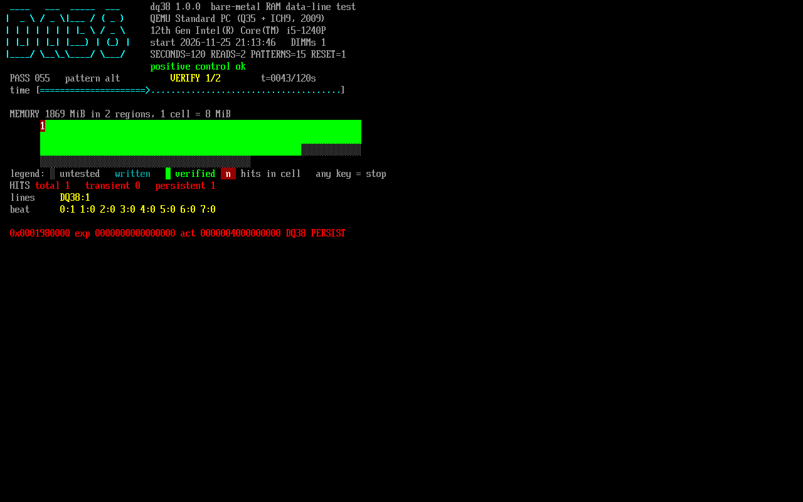
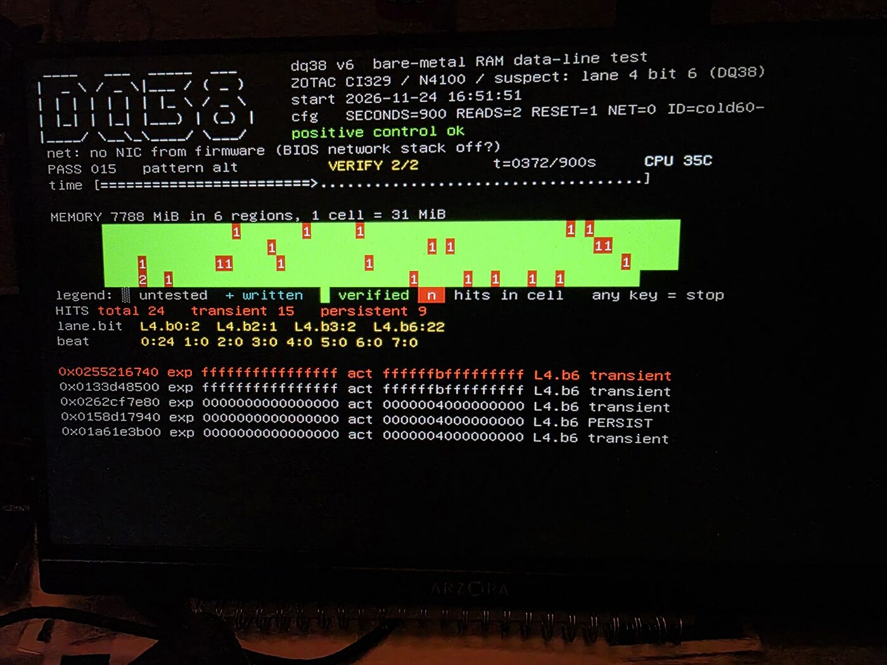

<div align="center">

# dq38

**A bare-metal UEFI RAM test that tells you *which data line* flips.**<br>
No operating system, 22 KB, boots from a USB stick. It counts every error by DQ line, byte lane, bit and burst beat, and tells a bad transfer from a bad stored value.

[](flake.nix)
[](#limits)
[](#run-it)
[](LICENSE)



<sub>The status screen in QEMU, running the built-in self-test that fakes one stored error on DQ38.</sub>

</div>

---

## What it is

Most RAM testers answer one question: *is there an error, and at which address?* That is
enough when a memory cell is broken. It is not enough when the problem sits **on the way to the
memory**: a weak data line, a bad solder joint, a slot contact, or a marginal signal that only
fails when the board is cold. Then the errors are spread over the whole address range and look
random, and swapping DIMMs around without a plan proves nothing.

dq38 asks a different question: *on which wire does the error arrive?* For every flipped bit it
records:

| | what | why it matters |
|---|---|---|
| **DQ line** | the bit position 0–63 in the 64-bit data word, shown as `DQ38` | the same line failing again and again means one signal, not one cell |
| **byte lane / bit** | DQ38 = byte lane 4, bit 6 | byte lanes map to DRAM chips and to groups of traces on the board |
| **beat** | which 8-byte word of the 64-byte cache line (burst beat 0–7) | a fault in one beat only points at timing in the burst |
| **transient / persistent** | re-read from cache, then `CLFLUSH` and re-read from DRAM | *transient*: the read went wrong, DRAM holds the right value. *persistent*: the wrong value is stored, so the write path is involved too |
| **address bits** | how often each physical address bit was set among the hits | a bit that is always 0 or always 1 points at one channel, rank, bank or column |
| **map cell** | where in the address range the hits are | spread over everything, or clustered |

Before every run a **positive control** flips eight known bits on purpose (one per byte lane,
each on another bit and in another beat) and checks that the test finds all of them at the right
address, line and beat. If it does not, dq38 refuses to run, because a test that cannot find a
known fault proves nothing when it finds none.

## Why it is called dq38

It was written for exactly one fault and named after it.

The machine was a fanless ZOTAC CI329 nano (Intel Celeron N4100, two DDR4 SO-DIMM slots) that
served as the home router of [devfbe](https://github.com/devfbe). It crashed now and then, always
after a cold start, never when warm. Crash dumps showed kernel code where one byte had turned
from `0x0f` into `0x4f`: bit 6 set. A burn-in under Linux and a memtest ran clean for days.

A pattern test under Linux finally showed what was going on. Every single error, in hundreds of
hits, was **bit 6 of byte 4 in the first 8 bytes of a cache line**. In the 64-bit data word that
is bit 4 × 8 + 6 = **38**, the data line **DQ38**. The errors only came when the box was cold
(room air below about 30 °C, case open, after it had been off for a while).

To take Linux out of the equation the test was rewritten as a UEFI application that runs before
any operating system: this program. It found the same fault on the same line on bare metal.
Then it found the cause with a four-step proof:

1. each DIMM alone in the **upper** slot: clean in the cold;
2. each DIMM alone in the **lower** slot: the board would not boot, or the positive control failed;
3. both DIMMs: 58 hits in 69 seconds, all on byte lane 4, all in one memory channel;
4. DIMMs swapped: hits after 5 seconds, at the same address pattern, which stayed with the slot.

So the **lower SO-DIMM slot** (or its traces) was bad, not the memory. The router runs on
one DIMM in the upper slot since then. The full investigation (in German) is at
[becker.koeln/ai/dimmfailure.html](https://becker.koeln/ai/dimmfailure.html).



<sub>An earlier version on the real machine, cold: 24 hits after six minutes, nearly all on DQ38
(shown as lane 4, bit 6 back then), spread over the whole memory.</sub>

The name stayed. The program has nothing specific to that machine any more: it shows any
board, any CPU, and ranks whatever lines fail.

## Run it

dq38 is a single `x86_64` UEFI application. It needs **Secure Boot off** (it is not signed), or
you sign it yourself, for example with `sbctl sign`.

### From a USB stick

Download `dq38-usb.img` from the [releases](https://github.com/devfbe/dq38/releases) (or
[build it](#build-it-yourself)) and write it to a stick. **This erases the stick.**

```sh
sudo dd if=dq38-usb.img of=/dev/sdX bs=4M conv=fsync status=progress
```

Boot from the stick (firmware boot menu). The stick holds `\EFI\BOOT\BOOTX64.EFI` (dq38) and
`\dq38\run.cfg`. The log is written back to the stick as `\dq38\dq38.log`, so you can read it on
another computer afterwards.

### From an existing EFI system partition

Copy `dq38.efi` anywhere on the ESP and start it from the UEFI shell or a boot loader. With
systemd-boot, for example:

```sh
sudo mkdir -p /boot/EFI/dq38 /boot/dq38
sudo cp dq38.efi /boot/EFI/dq38/
sudo cp run.cfg /boot/dq38/
printf 'title dq38 RAM test\nefi /EFI/dq38/dq38.efi\n' | sudo tee /boot/loader/entries/dq38.conf
sudo bootctl set-oneshot dq38.conf   # next boot only
```

`run.cfg` and the log always live in `\dq38\` on the volume dq38 was started from.

## Configuration

`\dq38\run.cfg`, one `KEY=value` per line; everything else is ignored. Without the file you get
the defaults.

| key | default | meaning |
|---|---|---|
| `SECONDS` | `600` | run time; a started pass is always finished |
| `READS` | `3` | how often each written pattern is read back |
| `PATTERNS` | `15` | bit mask: 1 zero, 2 ones, 4 alt (`00`/`FF` every 8 bytes, every line toggles each beat), 8 alt-inv |
| `RESET` | `0` | `0`: wait for a key at the end, then return to the firmware. `1`: cold reset 5 s after the end, for unattended runs |
| `IDLE`, `IDLE_MS`, `ALT`, `PARK`, `MWAIT`, `HLT` | off | idle experiments: let the CPU sleep so the memory goes into power-down / self-refresh, then test the first read after wake-up (see [`run.cfg`](run.cfg)) |
| `INJECT` | off | self-test: flip one stored bit on this DQ line (0–63) after the first write pass |

Any key stops a run early (after the current pass).

## Reading the results

The screen shows the map of the tested memory (one cell per 1/256 of it, red with the hit
count when something failed), the totals, the failing **lines** ranked by count, the **beat**
histogram and the last five hits. The log has every hit (up to 400) with all the details, and a
summary like this:

```
SUMMARY passes=4 seconds=69 hits=58 transient=12 persistent=46 temp=29C
  DQ32 (byte lane 4, bit 0): 3
  DQ34 (byte lane 4, bit 2): 1
  DQ35 (byte lane 4, bit 3): 4
  DQ36 (byte lane 4, bit 4): 2
  DQ38 (byte lane 4, bit 6): 54
  beat 0: 58
```

That is the real summary of step 3 above (both DIMMs, cold), in today's format: one byte lane,
one beat, one line dominating (that run predates the address-bit line). Some hits flip more than one bit, so the line counts add up to
more than the hit total.

Some rules of thumb:

- **One line, many addresses** → a signal problem on that line (slot, trace, solder joint, the
  DRAM chip's pin), not a bad cell. Move the DIMM to another slot and see if the line moves with
  it.
- **Many lines, one address** → a bad cell or row. Classic memtest territory.
- **Mostly transient** → the read path; **persistent ones too** → the value was stored wrong.
- **Only cold** → a marginal contact or timing. Test the way the fault happens: case open, cold
  room, machine off for a while, then start dq38 right away. A warm burn-in can run clean for
  days and still miss it; that is exactly what happened here.

**DQ numbers are logical.** `DQ38` means bit 38 of the 64-bit word the CPU sees. Boards and
DIMMs are allowed to swap bits within a byte lane, and sometimes whole lanes, so this is not
necessarily pin DQ38 on the module. The *consistency* is what matters: the same logical line
failing everywhere is one physical wire, whatever its name on the schematic.

## Limits

- `x86_64` UEFI only (it uses `CLFLUSH`, `RDTSC`, `MONITOR`/`MWAIT`).
- It tests the memory the firmware hands out as free. About 128 MiB stay with the firmware, plus
  whatever the firmware itself occupies, so not every byte is covered. For full coverage use
  memtest86+ alongside it.
- On systems with ECC, the memory controller corrects single-bit errors before dq38 sees them.
- Patterns are simple on purpose (solid and toggling lines). This is a tool for finding *which
  line* fails, not a replacement for a full memory test suite.
- CPU temperature is only shown on Intel CPUs (digital thermal sensor).

## Why there is no network telemetry

Earlier versions sent every log line as a UDP broadcast over the onboard network card. The
reason: during the hunt, the router was power-cycled by a smart plug over and over, cold-start
after cold-start, with nobody watching the screen. The results only arrived once Linux had booted
again and the log could be copied off the disk, and if a run crashed the machine, they did not
arrive at all. Streaming the lines live over the point-to-point cable to a laptop would have
shown every hit the moment it happened.

It never worked: the firmware's network driver (Realtek, through UEFI's Simple Network Protocol)
reported every frame as sent, but nothing ever arrived on the wire. The feature was removed. The
log file on the boot volume is written before the long part of the run and again at the end.

## Build it yourself

```sh
nix build github:devfbe/dq38            # -> result/dq38.efi
nix build github:devfbe/dq38#image      # -> result (dq38-usb.img, 64 MiB)
nix flake check github:devfbe/dq38      # QEMU self-test, see below
```

The build is plain C, compiled with clang straight to a PE/COFF UEFI application and linked
with `lld-link` against the gnu-efi headers; no gnu-efi runtime is linked in. Warnings are
errors.

`nix flake check` boots the USB image in QEMU with OVMF firmware and `INJECT=38`, then reads the
log back from the image and checks that the positive control passed, that exactly one hit was
reported, on DQ38 / byte lane 4 / bit 6 / beat 0 as persistent, and that the run finished. CI
runs the same check on every push.

## License

[MIT](LICENSE)
